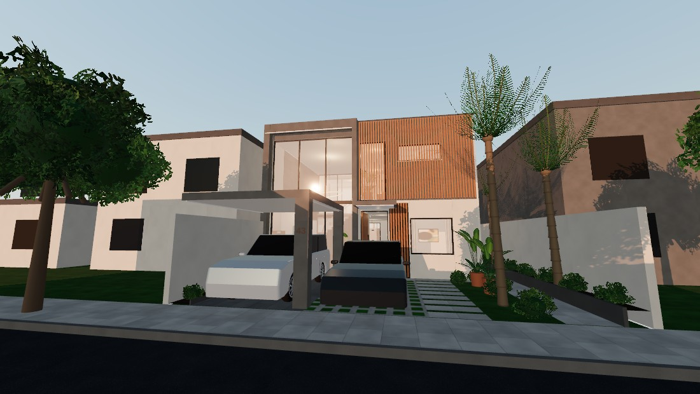
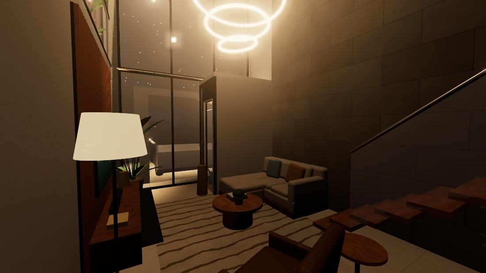
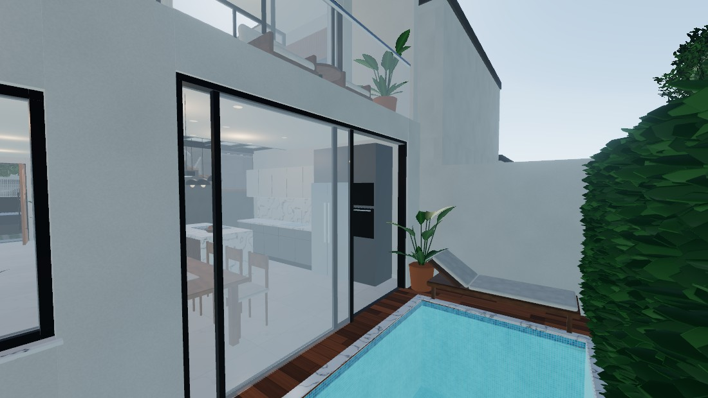

# Casa 43 — Passeio Virtual 3D

Modelo 3D navegável da residência do condomínio (terreno 10 x 20 m, dois pavimentos), feito a partir da planta do projeto. Dá para entrar em todos os cômodos em primeira pessoa, subir a escada, abrir e fechar portas, ver a casa de dia, ao entardecer e à noite, e olhar tudo de cima como maquete.



## Instalar (uma linha)

O instalador baixa a versão mais recente, baixa o programa que abre a casa numa janela própria (só na primeira vez, cerca de 100 MB) e cria a pasta **Casa 3D** e o atalho **Casa 3D** na sua Área de Trabalho. Ele não abre nada sozinho: a casa só abre quando você der dois cliques no atalho, e o programa fecha por completo quando você fecha a janela.

**macOS e Linux** (Terminal):

```bash
curl -fsSL https://raw.githubusercontent.com/dhqdev/home/main/install.sh | bash
```

**Windows** (PowerShell):

```powershell
irm https://raw.githubusercontent.com/dhqdev/home/main/install.ps1 | iex
```

No Prompt de Comando (cmd) do Windows, use:

```bat
powershell -NoProfile -ExecutionPolicy Bypass -Command "irm https://raw.githubusercontent.com/dhqdev/home/main/install.ps1 | iex"
```

Não precisa instalar Node, Python nem navegador. Se o download do programa falhar, o atalho abre a casa no navegador (`dist/index.html`).

### Atualizar

Abra o menu (`Esc`) e clique em **Buscar atualizações**. O programa baixa a versão mais nova do GitHub e reinicia sozinho. Quando houver versão nova, o próprio menu avisa. Rodar o comando de instalação de novo também atualiza.

## Como navegar

Ao abrir aparece o menu, com a lista de cômodos, o horário do dia, a qualidade gráfica, a música e as atualizações. Clique em um cômodo para ir direto para ele.

| Tecla | Ação |
| --- | --- |
| `W` `A` `S` `D` ou setas | andar (← → giram a visão) |
| mouse | olhar em volta (clique na tela para travar o mouse, ou arraste) |
| `Shift` | andar mais rápido |
| `E` ou clique | abrir / fechar a porta para a qual você está olhando |
| `L` | trocar o horário (manhã, meio-dia, tarde, pôr do sol, noite) |
| `V` | alternar entre caminhada e maquete 3D |
| `M` | aumentar o minimapa |
| `F11` | tela cheia |
| `Esc` | abrir o menu |

Na **maquete**: arraste para girar, role para dar zoom, use os botões para esconder o pavimento superior, a cobertura ou os vizinhos, e dê **duplo clique** em qualquer piso para começar a andar daquele ponto.

A qualidade **Automática** baixa ou sobe os gráficos conforme o computador aguenta. Se ficar lento, escolha **Média** ou **Baixa** no menu.

| | |
| --- | --- |
|  |  |
|  |  |

## O que foi modelado

Tudo segue a planta "Planta Baixa – Cotas, Alinhamento e Áreas (Corrigido)" (`assets/planta.jpg`): casa de 12,20 x 8,50 m com recuo lateral de 1,50 m, garagem na frente e piscina nos fundos.

**Térreo:** vaga coberta (2,80 x 5,00) e vaga descoberta em concregrama (2,70 x 5,00), passeio com faixas de grama, porta pivotante, escritório envidraçado (1,20 x 1,80), sala de estar com pé-direito duplo (3,80 x 4,80), sofá em "L" encostado na parede de pedra e TV de frente para ele na parede do corredor, escada em "L" com degraus flutuantes, cozinha/copa (6,20 x 3,90) com bancada, ilha com cooktop e banquetas, mesa de jantar, quarto 1, banho social, quarto 2, lavabo, despensa e lavanderia em sequência à direita, área gourmet com churrasqueira, deck e piscina 3,00 x 2,00.

**Superior:** mezanino/circulação com guarda-corpo de vidro sobre o vazio da sala, suíte master (3,50 x 3,20) com banho master e closet, recanto de leitura, suíte Isabela (3,00 x 3,00) com banho, estar íntimo, poço de luz e ventilação com claraboia sobre a cozinha e varanda de 1,50 m com vista para a piscina.

**Fachada:** pano de vidro do pé-direito duplo emoldurado em concreto, painel ripado de madeira no superior, esquadrias pretas, marquise com LED, número 43 e paisagismo tropical.

Móveis, cortinas, plantas, carros, texturas (madeira, porcelanato, mármore, concreto, grama, pastilha) e iluminação são gerados por código, sem arquivos externos. A música de fundo também é gerada na hora (sem direitos autorais).

## Premissas adotadas (onde a planta não fecha)

- **Profundidade:** escritório 1,20 + sala 4,80 + cozinha 6,20 = 12,20 m de casa, com 5,00 m de garagem na frente e 2,80 m de piscina/deck nos fundos.
- **Área gourmet:** fica coberta nos fundos, ao lado do deck, ligada à lavanderia por uma porta.
- **Varanda:** a faixa de 1,50 m do superior virada para a piscina virou uma varanda coberta com guarda-corpo de vidro.
- **Circulação do superior:** o trecho entre o closet e a suíte Isabela virou um recanto de leitura com janela.
- **Áreas:** o quadro de áreas da planta não fecha exatamente com as cotas desenhadas; o modelo respeita as cotas dos cômodos.
- **Alturas:** pé-direito de 2,80 m nos ambientes, 5,80 m no vazio da sala; escada com 17 degraus de ≈ 17,6 cm e piso de 28 cm.

Os dados da planta ficam em `src/plan.js` (cômodos) e `src/house.js` (paredes, vãos, escada), em metros, então dá para ajustar qualquer medida facilmente.

## Para desenvolvedores

```bash
npm install
npm run build   # gera dist/index.html
npm run dev     # recompila a cada alteração em src/
```

O programa de desktop fica em `app/` (Electron); o instalador baixa o Electron pronto, então não é preciso compilar nada. Para testar localmente: `npx electron app`.

Estrutura: `src/house.js` (arquitetura), `src/furniture.js` (móveis), `src/furnish.js` (posição dos móveis e luzes internas), `src/site.js` (terreno, garagem, piscina, jardim), `src/textures.js` (texturas procedurais), `src/main.js` (renderização, controles e menu), `src/music.js` (música ambiente). Feito com [three.js](https://threejs.org).
