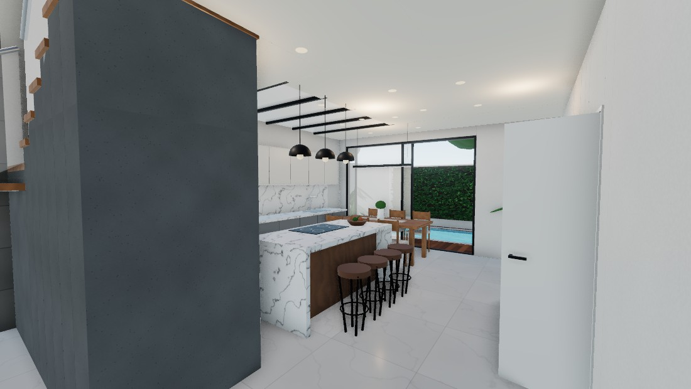
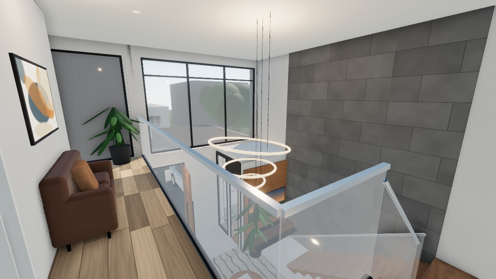

# Casa 43 — Passeio Virtual 3D

Modelo 3D navegável da residência do condomínio (terreno 10 x 20 m, dois pavimentos), feito a partir da planta do projeto. Dá para entrar em todos os cômodos em primeira pessoa, subir a escada, abrir e fechar portas, ver a casa de dia, ao entardecer e à noite, e olhar tudo de cima como maquete.


## Instalar (uma linha)

O instalador baixa a versão mais recente, cria a pasta **Casa 3D** e um atalho **Casa 3D** na sua Área de Trabalho e já abre a casa no navegador. Rodar de novo atualiza para a versão mais nova.

**macOS e Linux** (Terminal):

```bash
curl -fsSL https://raw.githubusercontent.com/dhqdev/home/main/install.sh | bash
```

**Windows** (PowerShell):

```powershell
irm https://raw.githubusercontent.com/dhqdev/home/main/install.ps1 | iex
```

No Prompt de Comando (cmd) do Windows, use:

```bat
powershell -NoProfile -ExecutionPolicy Bypass -Command "irm https://raw.githubusercontent.com/dhqdev/home/main/install.ps1 | iex"
```

Não precisa instalar Node, Python nem nada além de um navegador: a casa inteira é um único arquivo HTML (`dist/index.html`). No Linux, se não houver nenhum navegador, o script instala o Firefox. Para o melhor desempenho, use Chrome ou Edge com a aceleração de hardware ligada.

Depois de instalado, é só dar dois cliques no atalho **Casa 3D** da Área de Trabalho.

## Como navegar

| Tecla | Ação |
| --- | --- |
| `W` `A` `S` `D` ou setas | andar |
| mouse | olhar em volta |
| `Shift` | andar mais rápido |
| `E` ou clique | abrir / fechar a porta para a qual você está olhando |
| `T` | ir direto para um cômodo |
| `L` | alternar dia / entardecer / noite |
| `V` | alternar entre caminhada e maquete 3D |
| `M` | aumentar o minimapa |
| `Q` | qualidade gráfica (alta / média / baixa), se ficar lento |
| `Esc` | pausar e soltar o mouse |

Na **maquete**: arraste para girar, role para dar zoom, use os botões para esconder o pavimento superior, a cobertura ou os vizinhos, e dê **duplo clique** em qualquer piso para começar a andar daquele ponto.

| | |
| --- | --- |
|  |  |
|  |  |

## O que foi modelado

**Térreo:** garagem com vaga coberta e vaga descoberta (concregrama), entrada com porta pivotante, escritório envidraçado, sala de estar com pé-direito duplo (≈ 5,80 m), lustre de anéis e parede de pedra, escada em "L" com degraus flutuantes, cozinha/copa integrada com ilha e cooktop, mesa de jantar para 6, quarto 1, banho social, quarto 2, lavabo, despensa, lavanderia, área gourmet com churrasqueira, deck de madeira e piscina 3,00 x 2,00, corredor lateral de 1,50 m e jardim.

**Superior:** mezanino/circulação com guarda-corpo de vidro sobre o vazio da sala, suíte master com banho master e closet, suíte Isabela com banho, estar íntimo e poço de luz e ventilação sobre a cozinha (com claraboia).

**Fachada:** volume de concreto emoldurando o pé-direito duplo envidraçado, painel ripado de madeira, esquadrias pretas, marquise e garagem com LED quente, número 43 e paisagismo tropical.

Todos os móveis, texturas (madeira, porcelanato, mármore, concreto, grama, pastilha da piscina) e a iluminação são gerados por código, sem arquivos externos.

## Premissas adotadas (onde a planta não fecha)

A planta tem algumas medidas que não batem entre si. Onde isso aconteceu, o modelo seguiu a opção mais plausível:

- **Escritório:** a tabela diz 1,20 x 1,80, o desenho diz 1,60 x 1,80. Usei **1,60 x 1,80**, que é o que cabe ao lado da entrada.
- **Área gourmet:** somando quartos, banho, lavabo, despensa, lavanderia e gourmet lado a lado, a casa não caberia no lote junto com a garagem de 5 m e a piscina. A gourmet (≈ 2,90 x 3,00) ficou **coberta nos fundos, ao lado do deck**, ligada à lavanderia por uma porta.
- **Lavanderia:** ficou com cerca de 1,70 x 3,30 (maior que os 1,50 x 2,00 da tabela) para aproveitar o espaço; atrás do lavabo e da despensa há uma pequena área técnica fechada.
- **Corredor lateral:** tratado como passagem externa de 1,50 m ao longo de toda a divisa.
- **Superior:** o espaço sem nome entre o closet e o banho Isabela virou um **estar íntimo**. A "área de luz e ventilação" virou um poço de luz aberto, com claraboia sobre a cozinha.
- **Áreas:** o quadro de áreas da planta (72 m² + 68 m²) não fecha com as dimensões desenhadas dos cômodos; o modelo respeita as dimensões dos cômodos.
- **Alturas:** pé-direito de 2,80 m nos ambientes, 5,80 m no vazio da sala; escada com 17 degraus de ≈ 17,6 cm e piso de 28 cm.

Os dados da planta ficam em `src/plan.js` (cômodos) e `src/house.js` (paredes, vãos, escada), em metros, então dá para ajustar qualquer medida facilmente.

## Para desenvolvedores

```bash
npm install
npm run build   # gera dist/index.html
npm run dev     # recompila a cada alteração em src/
```

Estrutura: `src/house.js` (arquitetura), `src/furniture.js` (móveis), `src/furnish.js` (posição dos móveis e luzes internas), `src/site.js` (terreno, garagem, piscina, jardim), `src/textures.js` (texturas procedurais), `src/main.js` (renderização, controles e interface). Feito com [three.js](https://threejs.org).
